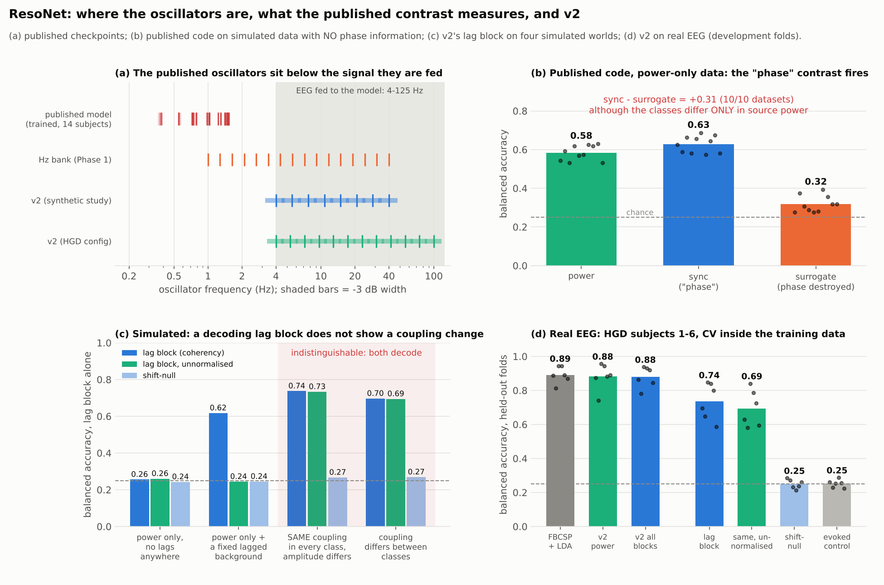

# ResoNet: a critique from its own artefacts, and a redesign (v2)

2026-11-09, corrected 2026-11-14 after the review board of 2026-11-13 (`docs/REVIEW_BOARD.md`). Independent second
look at the published Resonance Network (`reso-net/`, manuscript under review) and at this follow-up repository.
Every number below comes from a script in this repo, run on the published checkpoints, the published code,
synthetic data with known ground truth, or (Part 4.4 only) the training recordings of HGD subjects 1-6. No HGD
test recording was used.

**What the board changed.** Part 1 (the published model) held up under independent re-derivation. Part 4 did not
hold as first written: the board showed that my reading of v2's lag block went beyond the evidence. The affected
passages are corrected in place and marked.

## Bottom line
1. **The published model does not resonate with the EEG.** In all 14 published checkpoints the trained
   oscillators sit at 0.36-1.55 Hz. The data are band-passed 4-125 Hz.
2. **Its "phase synchronization" readout is a second-order (covariance-type) feature of learned spatial
   projections,** not a synchrony between brain rhythms.
3. **The surrogate control cannot separate phase from power.** It removes exactly the cross-terms through
   which source *power* shows at the sensors.
4. **The reported high-gamma effect is confounded with the sampling rate.**
5. The results themselves are reproducible and carefully evaluated; the *interpretation* (resonance, phase
   synchronization, high gamma) is what does not hold.
6. **ResoNet v2** (`resonet_sync/v2.py`) is a redesign that does what the paper describes: resonators in the
   band, and a readout that splits power, zero-lag covariance and a lag block.
   - On real EEG (HGD subjects 1-6, cross-validation inside the training recordings; development only) it matches
     FBCSP as a decoder (0.88 against 0.89; the published model's arms score about 0.53 on the test session).
   - Its lag block alone decodes movement class at 0.74 (chance 0.25, nulls at chance), but adds nothing once power
     is in the model.
   - **It does not make the phase question testable** (review board 2026-11-13). A world in which the same lagged
     coupling is present in every class and only source amplitudes change reproduces the real-data pattern. The
     lag block cannot tell that world from one where coupling changes.
7. **Decisions of the board** (Tom delegated them): tell the co-authors about items 1-4 now; do not spend the
   untouched HGD data on a confirmatory v2 test; stop Phase 1 at 6 of 14 subjects (DEVIATION 28).

## Part 1. What the published model computes

### 1.1 Nothing resonates
`scripts/published_forensics.py` reads `reso-net/results_hg/RNsync_S*.pt`.

| | frequency | half-bandwidth |
|---|---|---|
| initialisation (`omega ~ U(0.5, 4)`, `h = 0.01`, 250 Hz) | 0.20-1.59 Hz | 0.16-0.40 Hz |
| after training, all 14 subjects | **0.36-1.55 Hz** | 0.16-0.41 Hz |
| data (cache) | **4-125 Hz** | |

The oscillator frequency is `omega * h` radians *per sample*, so its value in Hz depends on the sampling rate.
At 250 Hz every oscillator lies below the 4 Hz high-pass, and training does not move it. The code comment says
as much: "the abstract omega timescale does not align with literal EEG-band Hz".

### 1.2 Consequences for the trained model (subject 1; the others are alike)
- **One filter, not a bank.** Over 4-124 Hz the 16 gain curves correlate above 0.9995. Each oscillator is the
  same low-pass with a 1/f slope: +22.8 dB at 4 Hz, +13.1 at 10 Hz, +3.0 at 30 Hz, -5.5 at 100 Hz.
- **Almost all of the output is 4-8 Hz.** For a 1/f input, 82% of the output power comes from 4-8 Hz, 94% from
  below 13 Hz and 1.2% from above 30 Hz.
- **The 16 frequencies hardly matter.** Give all oscillators one shared frequency and damping: the sync features
  correlate 0.98 with the original (median 0.82 per feature across trials).
- **The "phase" is not an oscillation phase.**
  - A resonating complex oscillator passes +f and rejects -f (36 dB for a 10 Hz resonator of this bandwidth).
    Here the difference is 4.9 dB at 4 Hz and 0.6 dB at 30 Hz.
  - The oscillator state rotates *backwards* in 42% of samples (median instantaneous frequency 2 Hz, interquartile
    range -6 to +11 Hz).
  - What the phase is: each oscillator's state is a low-passed complex number whose real and imaginary parts are
    two different spatial projections of the EEG (the complex encoder). Its angle is the ratio of those two
    projections.

So `C_ij = <u_i conj(u_j)>` is a zero-lag cross-moment between pairs of amplitude-normalised, learned spatial
projections of low-passed EEG. (The unit-phasor normalisation is nonlinear, so it is not strictly a second-order
statistic; the information it carries is of the covariance type.) That is the information class that CSP and
Riemannian (covariance) decoders use. It is how
**source power** appears at the sensors: a source that gets stronger changes the covariance between every pair of
projections that see it.

**Checked on the trained nonlinear model** (review board 2026-11-13, Volkov; subject 1's checkpoint driven with
128-channel 1/f noise in 4-124 Hz):
- The linear analysis applies. The trained operator is contracting in all 14 subjects, the cubic term is 0.5%
  (median) to 20% (maximum) of the damping, nothing self-sustains after the input is switched off, and the sync
  features correlate 0.994 with those of an uncoupled linear bank on the same drive.
- One nuance: 14% of the output power lies below 3 Hz (41% if the input saturates the tanh), although the input has
  none there. The tanh encoder creates slow intermodulation products, and at those frequencies the oscillators do
  resonate. These products follow the input's amplitude envelope, so this pathway is power-type information too.

### 1.3 The surrogate control does not isolate phase
The paper's central contrast is `sync - sync_surrogate` (+0.163, 14/14, nonlinear bank). The surrogate rolls
each oscillator's series by a fixed lag (74-1056 samples). Because the states are broadband, any such lag removes
all cross-terms between projections. So the contrast shows that *cross-covariance between projections is
informative*, which is true whenever classes differ in source power.

Section 1.6 tests this on data with known ground truth: the contrast is +0.31 when the classes carry no phase
information at all.

### 1.4 The bandwidth finding changed two things at once
The paper reads "restricted vs full band" as the effect of high gamma ("the same experiment ... changing only the
input frequency band"). But:
- the restricted run used `decim = 4` (125 Hz) and the full-band run `decim = 2` (250 Hz)
  (`reso-net/results/ablation_summary.json`, `results_hg/ablation_summary.json`);
- because oscillator parameters are per sample, halving the sample interval also halves every oscillator
  frequency in Hz (0.1-0.8 Hz -> 0.2-1.6 Hz), halves every time constant in seconds and doubles the samples per
  trial;
- the trained oscillators pass about 1% of their output power from above 30 Hz (1.2).

The +0.12 to +0.17 gain is real, but it cannot be attributed to the 70-125 Hz band. The missing control is cheap:
low-pass the full cache at 48 Hz and keep `decim = 2`.

### 1.5 What stands
- The evaluation is careful: leakage-safe splits, per-subject paired statistics, honest baselines
  (ShallowConvNet 0.749 against 0.53 for the RN arms).
- "Linear is as good as nonlinear": the coupled Hopf dynamics do not earn their cost. This repo's later checks
  agree (the bank is a damped linear filter with weak crosstalk).
- The instinct to control for readout capacity is right. The control chosen does not do it (1.3, and it adds a
  dilution penalty: DEVIATION 24).

### 1.6 The published code on data with known ground truth
`scripts/published_null_test.py`: the published linear model (`FastResonanceNetwork`, N = 16) and the published
training loop, on simulated HGD-like trials (16 channels, 4.5 s, 4 classes, 80 + 40 trials per class, high-passed
at 4 Hz like the real cache). Ten datasets per generator, seeds 3200-3209. Test balanced accuracy:

| generator | power | sync | surrogate | sync_imag | **sync - surrogate** |
|---|---|---|---|---|---|
| G0: classes carry nothing | 0.249 | 0.242 | 0.246 | 0.244 | -0.003 [-0.025, +0.019] |
| **G1: classes differ only in source power** | 0.584 | 0.627 | 0.319 | 0.606 | **+0.309 [+0.266, +0.352], 10/10** |
| HGD, as published (linear / nonlinear bank) | 0.526 / 0.533 | 0.528 / 0.530 | 0.378 / 0.367 | - | +0.150 / +0.163 |

(90% CI. G1: four independent narrowband sources with random phases; the class is which source is 15% weaker. There
is no phase relation between anything.)

- **The paper's "phase" contrast is +0.31 on data with no phase information.** A power-only world reproduces the
  whole published pattern: sync about equal to power, surrogate near chance.
- **`sync_imag` is not robust to volume conduction here.** The imaginary-coherence readout that the code calls
  "volume-conduction-robust" decodes power-only data at 0.61. With a complex encoder, real and imaginary parts
  of the coherence both mix zero-lag covariances.
- **What this does and does not establish** (review board, Halvorsen): the contrast is not specific to phase. It does
  not establish that the HGD effect is a power effect. The supported statement is that the control cannot tell
  the two apart.
- A first run without the 4 Hz high-pass was discarded (`partial_UNFILTERED_discarded.json`): the simulated sensor
  noise then drove the 0.2-1.6 Hz oscillators at resonance, which cannot happen on the real cache.

## Part 2. What this means for the manuscript
These are the authors' decisions. My reading of what the evidence supports:
- **Finding 1** ("phase synchronization carries capacity-controlled class information beyond band power") is not
  supported as worded. Supported: *a fixed-lag surrogate that removes the cross-terms between learned spatial
  projections costs 0.15-0.16 accuracy.* The same happens when classes differ only in source power (1.6), so the
  result does not show phase synchronization.
- **"Resonance", "Hopf oscillator", "PLV"** describe the equations, not the trained model's behaviour on this
  data. State the oscillator frequencies in Hz.
- **Finding 2** (high gamma) needs the same-sampling-rate control before it can be claimed.
- The checks are quick to reproduce (`scripts/published_forensics.py` takes seconds). I would raise them with the
  co-authors before the review goes further.

## Part 3. Critique of this follow-up repository
- **It inherited the flaw it set out to fix, in milder form.** The Hz-parameterised bank put the frequencies in
  the band (1-40 Hz) but kept the published 0.16-0.40 Hz bandwidths. Sixteen such lines cover a few percent of the
  band, six of them lie below the cache's 4 Hz high-pass, and each oscillator still has its own frequency *and* its
  own complex spatial filter. So "coherence between oscillators" still mixes a frequency difference with a spatial
  difference.
- **Phase 1 replicates a model that is a weak decoder by construction,** and DEVIATION 24 already established
  that its contrasts cannot be called phase. The board stopped it at 6 of 14 subjects (DEVIATION 28).
- **Process outgrew results.** 26 deviations, 11 synthetic screens and three review-board rounds went mainly
  into a coupling-detection rule that could not work (the formal reason came late:
  `docs/NONIDENTIFIABILITY.md`) and into an hc-5 plan whose probes very likely lack laminar coverage. The
  controls were sound; the order was wrong. The checks in Part 1 take minutes and should have come first.
- **My first reading of v2 repeated the paper's mistake in a new form** (added 2026-11-14). I took a control that
  passed five pre-set simulated worlds as proof that the lag block is specific to coupling, and proposed its
  contrast L for a confirmatory test. Two further worlds from the review board showed that neither can show a
  change in coupling (4.3, 4.4). A control is only as good as the alternatives it was tested against.
- **A fidelity gap in the synthetic data.** The calibration generators add white sensor noise down to 0 Hz. The
  real cache has no power below 4 Hz. This matters for any bank with oscillators below 4 Hz (the published one
  entirely; six of the Hz bank's sixteen). `scripts/published_null_test.py` high-passes at 4 Hz for that reason.

## Part 4. ResoNet v2
`resonet_sync/v2.py` (model), `resonet_sync/v2_probe.py` (closed-form path), protocol in DEVIATION 27.

### 4.1 Design: three changes
1. **Resonators that tile the band, in Hz.** Log-spaced centre frequencies with constant-Q bandwidths, so each
   resonator's upper -3 dB edge is the midpoint to the next centre. (Synthetic study: 8 bands over 4-40 Hz. HGD:
   12 bands over 4-100 Hz.)
2. **Several real spatial filters per band, no tanh.** `z[f, s](t)` is band f's resonator applied to the real
   projection `w[f, s] . x(t)`: the analytic band signal of one spatial component. The filters can start from CSP
   (closed form, training trials only).
3. **A readout that separates what can and cannot come from power.** Within each band, the cross-spectral matrix
   of the S projections is split into three blocks:

| block | what it is | responds to source power / volume conduction | responds to lagged coupling |
|---|---|---|---|
| power | log band power of each projection | yes | only through mixing |
| re | real part of the coherency between projections (zero lag) | yes | through cos(lag) |
| **im** | imaginary part of the coherency (the lag block) | no, **if the data contain no lagged structure at all** | yes, through sin(lag) |
| **im_raw** | unnormalised imaginary cross-spectrum (added after the review board) | only to the power of sources that are themselves lagged | yes |

For real weights, `Im C = w^T Im(S_x) w'`, and instantaneous mixing of independent sources has `Im(S_x) = 0`
whatever the source powers (Nolte et al. 2004). The dimension-matched control replaces the lag block by the same
quantity after a fresh circular shift per trial and projection (`im_null`).

**Corrected by the review board (2026-11-13).** The original claim here, "the lag block cannot respond to source
power", was too strong.
- With coherency normalisation, the block divides by the projections' powers. If the data contain any lagged
  structure, even one that is the same in every class, the power of unrelated sources changes the block
  (trap `T_bg`: 0.62 on power-only classes). The unnormalised block `im_raw` stays at chance there (0.24).
- No version of the block separates "the coupling changed" from "the amplitude of sources with a fixed lagged
  coupling changed" (trap `T_amp`: 0.74 for both versions, with the same coupling in every class).

### 4.2 Exact properties (unit tests, `tests/test_v2.py`)
- The bank is linear and causal and equals the one-pole recursion; unit gain at resonance.
- One source seen through any real mixing gives coherency exactly +/-1 with zero imaginary part at any source
  power; a lagged second source gives a non-zero imaginary part.
- The null arm leaves the power and re blocks untouched and consumes the global random stream exactly like the
  real arm.
- With a class-independent lagged pair in the background, the coherency block follows the power of an unrelated
  source and the unnormalised block does not (regression test for the board's finding).
- A resonator of order n equals n one-pole recursions in series, keeps unit gain at resonance and the -3 dB
  width, and has a much steeper skirt.

### 4.3 Ground truth (synthetic; criteria frozen in DEVIATION 27 before the runs)
L = accuracy(power + re + im) - accuracy(power + re + im_null). Ten new datasets per generator.

**Closed-form path** (CSP filters, untrained resonators, shrinkage LDA; seeds 3700-3709): **L passes all five
criteria.**

| generator | lag block alone | its null | L (90% CI) | FBCSP + LDA | oracle |
|---|---|---|---|---|---|
| G0: classes carry nothing | 0.242 | 0.245 | +0.002 [-0.014, +0.019] valid | 0.246 | 0.227 |
| G1: source power only | **0.256** | 0.243 | -0.007 [-0.028, +0.014] valid | 0.653 | 0.686 |
| G1r: one source's power | **0.267** | 0.254 | +0.011 [-0.006, +0.029] valid | 0.696 | 0.676 |
| G2: coupling, mixed lags | 0.574 | 0.262 | **+0.126** [+0.097, +0.154] sensitive | 0.658 | 0.785 |
| G2i: lagged coupling only | **0.696** | 0.269 | **+0.378** [+0.356, +0.400] sensitive | 0.268 | 0.752 |

- On power-only data without any lagged structure the lag block is at chance (0.26, 0.27), where the published
  `sync` and `sync_imag` readouts scored 0.63 and 0.61 (1.6).
- On lag-only data it reaches 0.70 (oracle 0.75) while power and FBCSP are at chance.

**Trap worlds added by the review board** (`scripts/v2_probe_run.py --traps`, seeds 3800-3809; the unnormalised
block for G1 and G2i comes from a rerun on the same seeds, which reproduces every stored value exactly):

| world (no coupling parameter differs between classes in the first three) | power | lag block (coherency) | lag block (unnormalised) | shift-null | L (90% CI) |
|---|---|---|---|---|---|
| G1: source power only, no lags anywhere | 0.604 | 0.256 | 0.260 | 0.243 | -0.007 [-0.028, +0.014] |
| `T_bg`: power only + one fixed lagged pair in the background | 0.998 | 0.618 | 0.244 | 0.244 | -0.001 [-0.003, +0.001] |
| `T_amp`: SAME lagged coupling in every class, pair amplitude differs | 0.938 | 0.737 | 0.733 | 0.267 | +0.034 [+0.022, +0.045] |
| G2i: lagged coupling differs between classes | 0.270 | 0.696 | 0.694 | 0.269 | +0.378 [+0.356, +0.400] |

- `T_bg`: the coherency block decodes power-only classes (0.62) because it divides by power. The unnormalised
  block does not (0.24).
- `T_amp`: both blocks decode (0.74, 0.73) and L is positive, although the coupling is the same in every class.
- **So the five pre-set criteria were passed, but they did not include these worlds. L is no longer used as a
  contrast** (DEVIATION 27, addendum 3).

**Trained path** (random spatial filters, the Phase 1 training loop; seeds 3600-3609): **L passes all five
criteria.**

| generator | L (90% CI) | v2 power + re + im | v1 `lin:sync+power` | FBCSP + LDA | oracle |
|---|---|---|---|---|---|
| G0 | -0.009 [-0.031, +0.013] valid | 0.247 | - | 0.259 | 0.235 |
| G1 | -0.022 [-0.035, -0.009] valid | 0.611 | 0.511 | 0.669 | 0.675 |
| G1r | -0.013 [-0.043, +0.017] valid | 0.586 | 0.544 | 0.689 | 0.681 |
| G2 | **+0.161** [+0.139, +0.183] sensitive | 0.721 | 0.641 | 0.634 | 0.753 |
| G2i | **+0.466** [+0.450, +0.483] sensitive | 0.725 | 0.644 | 0.253 | 0.756 |

- Trained v2 beats the Phase 1 bank's best arm on every informative generator (+0.04 to +0.10).
- On power-only data L is slightly negative (-0.02): the real lag block is fixed noise that the head can memorise,
  while the null is redrawn every epoch. The bias is conservative for a "lag adds" claim.
- The Phase 1 bank does see lag-only coupling (0.64 on G2i). Its problem is the opposite one: its sync readout also
  responds to power, so a positive result cannot be attributed.

### 4.4 Real EEG: HGD development subjects 1-6 (cross-validation inside the training recordings)
`scripts/build_hgd_dev_cache.py`, `scripts/v2_probe_run.py`. Published preprocessing; cap 80 trials per class;
5-fold CV inside the training split. **The test recordings were not downloaded.** These are development numbers:
descriptive, no inference.

Closed-form v2, 12 bands 4-100 Hz x 8 CSP filters, shrinkage LDA. Balanced accuracy on held-out folds (chance 0.25):

| subject | FBLV + LDA | FBCSP + LDA | v2 power | v2 power+re+im | same with null lag block | L | lag block alone | its null | evoked control |
|---|---|---|---|---|---|---|---|---|---|
| 1 | 0.744 | 0.887 | 0.875 | 0.863 | 0.831 | +0.031 | 0.697 | 0.284 | 0.263 |
| 2 | 0.700 | 0.812 | 0.741 | 0.781 | 0.734 | +0.047 | 0.647 | 0.272 | 0.228 |
| 3 | 0.844 | 0.944 | 0.956 | 0.938 | 0.906 | +0.031 | 0.847 | 0.231 | 0.253 |
| 4 | 0.828 | 0.944 | 0.944 | 0.931 | 0.903 | +0.028 | 0.841 | 0.212 | 0.287 |
| 5 | 0.781 | 0.891 | 0.881 | 0.919 | 0.863 | +0.056 | 0.800 | 0.237 | 0.256 |
| 6 | 0.731 | 0.869 | 0.891 | 0.844 | 0.819 | +0.025 | 0.588 | 0.263 | 0.225 |
| **mean** | 0.771 | 0.891 | **0.881** | 0.879 | 0.843 | **+0.036** | **0.736** | 0.250 | 0.252 |

- **As a decoder, v2 matches the standard method on these folds.** v2 power 0.881 against FBCSP 0.891 (difference
  -0.010, SD 0.033 over the six subjects). On the same folds of subject 1, the Phase 1 bank's best arm
  (`lin:sync+power`, trained) scored 0.516 and trained v2 with 4 random filters per band 0.68
  (`results/v2_hgd_dev/`). The step that mattered was the number and initialisation of the spatial filters, not
  gradient training (DEVIATION 27, addendum 1).
- **The lag block decodes the class: 0.74 alone** (0.59-0.85 per subject), with its shift-null at chance (0.25) and
  the evoked control at chance (0.25).
- **It adds nothing to decoding.** power + re + im (0.879) does not beat power alone (0.881). Against the matched
  null block L is +0.036 (positive in 6/6 subjects).

**What the lag result does and does not show (corrected by the review board, 2026-11-13).** I first wrote here
that "real movement EEG contains class-dependent, time-lagged structure" and that "no instantaneous mixture of
independent sources can produce that". The second sentence is true and beside the point; the first went too far.
- **Shown:** the EEG has lagged structure between spatial components (a non-zero imaginary cross-spectrum), it is
  not locked to the cue, and its sensor-level expression differs between movement classes.
- **Not shown:** that coupling differs between classes. Trap `T_amp` has the *same* lagged coupling in every class;
  only the amplitude of the coupled sources depends on the class. It gives lag block alone 0.74 and L = +0.034
  (`results/v2_probe/traps.json`). The real data give 0.74 and +0.036.
- **L is not evidence of information that only the lag block has.** L is +0.055 to +0.075 when the lag block is a
  noisy linear function of power and carries nothing of its own (Halvorsen). The noise null controls the number
  of features, not their redundancy with power.
- **Withdrawn:** the "regress out power" control that I reported here (0.33). It gives 0.32-0.35 whether the lag
  block has information of its own or none (Zhao), so it decides nothing.

**Rerun with the unnormalised lag block** (`--tag raw`; same folds; reading fixed in DEVIATION 27, addendum 3,
before the run). The board showed that the coherency normalisation lets the power of unrelated sources into the
lag block (trap `T_bg`). The unnormalised block `im_raw` does not have that leak.

| subject | lag block (coherency) | its shift-null | unnormalised lag block | its shift-null | evoked control |
|---|---|---|---|---|---|
| 1 | 0.697 | 0.284 | 0.628 | 0.294 | 0.263 |
| 2 | 0.647 | 0.272 | 0.581 | 0.287 | 0.228 |
| 3 | 0.847 | 0.231 | 0.841 | 0.266 | 0.253 |
| 4 | 0.841 | 0.212 | 0.787 | 0.237 | 0.287 |
| 5 | 0.800 | 0.237 | 0.725 | 0.328 | 0.256 |
| 6 | 0.588 | 0.263 | 0.594 | 0.300 | 0.225 |
| **mean** | **0.736** | 0.250 | **0.693** | 0.285 | 0.252 |

- **The unnormalised block stays far above chance: 0.69** (0.58-0.84 per subject). So the earlier 0.74 did not come
  from unrelated power leaking in through the normalisation. Under the reading fixed in advance, this means: the
  sources that movement modulates have lagged structure themselves.
- **It still does not show a change in coupling** (`T_amp`: 0.74 for the unnormalised block as well).
- The shifted unnormalised block scores 0.29, a little above 0.25. Its mean is zero in every class, but its spread
  grows with the projections' amplitudes, and a linear classifier can use a difference in spread slightly.
- The shared-key numbers of this rerun are identical to the first run (maximum difference 0).

**Where the lag information sits, and two caveats.**
- By band, the lag block alone scores 0.58-0.65 at 10-31 Hz, 0.32-0.41 at 4-7 Hz and 0.35-0.40 above 40 Hz; power
  alone follows the same profile (0.67-0.77 at 10-31 Hz) (`scripts/v2_probe_controls.py`).
- The simplest reading (Echeverria): mu/beta rhythms with a fixed lagged spatial structure (for example lagged
  source pairs or travelling waves) whose amplitude changes with the movement. Power and the lag block then change
  together.
- **Caveat 1: band labels are approximate.** The one-pole resonators leak (4.5). The profile above was measured
  with them.
- **Caveat 2: a timing offset between channels is excluded for the mu band only** (Asante). A fixed delay turns
  zero-lag covariance into imaginary cross-spectrum in proportion to frequency.
  - Fitted delays against the channel average are within about +/-0.2 ms (5-95% range; an upper bound, since real
    lags are included), with no ramp over channel index.
  - At 12.9 Hz, injected offsets of 0.1-1 ms leave the lag block's accuracy unchanged (0.719).
  - At 23.2 Hz, a 0.1 ms offset already produces 13-20% of the (small) class effect. For the beta band and above,
    a hardware timing offset is not excluded as a contributor.
- **Not controlled: EMG and movement artefacts.** The movements are executed. No physiological claim should rest on
  these numbers before a control on artefact-cleaned data (Echeverria).

### 4.5 Front end: the resonators leak across bands, and a fix (board finding, Asante)
`scripts/resonator_leakage.py`, DEVIATION 27 addendum 4 (reading fixed before the decoding run).
- **The problem.** A one-pole resonator's skirt falls only 6 dB per octave, and EEG has far more power at low
  frequencies than at high ones. So much of a band's output comes from lower frequencies, and the band labels above
  are approximate.
- **The fix.** `CrossSpectralBank(order=n)` cascades the pole n times (a complex gammatone) and widens each pole so
  that the -3 dB width stays the same. `order = 1` reproduces every earlier number exactly.

| training recordings, subjects 1-6 | order 1 | order 4 | 4th-order Butterworth |
|---|---|---|---|
| share of a resonator's output power from its own -3 dB band (12 bands) | 0.17-0.77 | 0.56-0.86 | 0.86-0.98 |
| share from below 40 Hz, in the four bands above 40 Hz | 68-81% | 10-56% | - |

| development folds, subjects 1-6 | order 1 | order 4 |
|---|---|---|
| v2 power | 0.881 | **0.908** |
| v2 power minus FBCSP (SD over subjects) | -0.010 (0.033) | +0.017 (0.047) |
| v2 power + re + im | 0.879 | 0.890 |
| lag block alone (coherency) | 0.736 | 0.732 |
| lag block alone (unnormalised) | 0.693 | 0.691 |
| shift-nulls (coherency, unnormalised) | 0.250, 0.285 | 0.239, 0.277 |
| L | +0.036 | +0.016 |

- **The lag results did not come from the leak.** Both lag blocks move by less than 0.005.
- **The decoder comparison depends on the resonator shape.** v2 power rose by 0.027, above the 0.02 mark fixed in
  advance. Most of it is one subject (subject 5: 0.881 -> 0.994; the other five: -0.012 to +0.031). So "v2 matches
  FBCSP" is the fair summary for either order, and neither difference is claimed on six development subjects.
- Adding the zero-lag and lag blocks to power now lowers accuracy slightly (0.890 against 0.908).
- Order 4 costs four complex pole updates per component instead of one. The spatial projection still dominates.

### 4.6 What v2 does and does not show
- **Decoder.** v2 is a member of a known family (filter bank + spatial filters + second-order features: FBCSP,
  Riemannian and cross-spectral methods; imaginary coherency is Nolte et al. 2004). It is not a new decoder. Its
  value here is that the ResoNet idea now does what the paper describes.
- **The phase question stays open.** The lag block answers "is there lagged structure whose sensor-level expression
  differs between classes?" It does not answer "does coupling between oscillators change?"
  - Two worlds give the same numbers: coupling that changes with the class, and a fixed lagged coupling whose
    sources change amplitude (`T_amp`). They differ in the coupled pair's own coherency, which sensors do not give
    without a source model (Volkov).
  - Even with a source model the question is not answerable at second order: a class-dependent coupling strength
    and class-dependent gains of three fixed generators have identical cross-spectra
    (`docs/NONIDENTIFIABILITY.md`, construction 3).
  - So no v2 contrast is offered as a confirmatory test, and none was run on untouched data.
- **What the zero-imaginary-part property needs:** instantaneous linear mixing, real spatial weights, the same linear
  filter for every projection in a band, no fixed timing offsets between channels, and **no lagged structure
  anywhere in the data**. Real EEG does not meet the last condition. With the unnormalised block the property
  weakens to: the block ignores the power of sources that are not themselves part of a lagged structure.
- **Training.** The closed-form path (CSP + LDA) is the validated one on real data. End-to-end training of the same
  model from CSP initialisation is implemented (`--csp-init`) but was only run on one fold.
- **Hardware.** Per sample, v2 needs one real projection and one complex one-pole update per component and per
  resonator order, plus running second moments. The HGD configuration (96 components, 128 channels, 250 Hz) is
  about 3.6 million multiply-adds per second before any pruning of channels; almost all of it is the projection.

## Part 5. What happens next (review board, 2026-11-13)
My first version of this part proposed a confirmatory v2 test on the untouched subjects. The board rejected that;
its decisions replace my list. Full record: `docs/REVIEW_BOARD.md`.

1. **Manuscript: tell the co-authors about Part 1 now.**
   - The three facts are properties of the authors' own files and reproduce in seconds.
   - Options for the authors: correct the interpretation (no "resonance", no "phase synchronization beyond band
     power", no high-gamma attribution) or withdraw and resubmit. How to approach the editor is their decision.
2. **Run the one experiment the paper lacks: the band x sampling-rate control.**
   - `scripts/bandwidth_control.py`; notebook section 4b. It needs the full cache and a GPU, so it runs on Colab.
   - Cells: the published model on the full cache low-passed at 48 Hz with `decim = 2`, and on the full band with
     `decim = 4`. Together with the two published runs this separates the band from the sampling rate.
3. **Confirmatory v2 test: not run.** Its lag contrasts would very probably "succeed" and could not support a
   coupling claim (4.4, 4.6). HGD test recordings and subjects 7-14 stay untouched.
4. **Phase 1: stopped at 6 of 14 subjects** (DEVIATION 28). The reasons do not depend on the interim outcome: no
   Phase 1 result could be called "phase" (DEVIATION 24), and the model it replicates does not resonate (Part 1).
5. **The phase question at second order is closed, in the negative** (added 2026-11-14;
   `docs/NONIDENTIFIABILITY.md`, construction 3; `scripts/nonident_check.py`, check 4).
   - The board asked for a statistic that stays at chance on both trap worlds and still detects a real coupling
     change.
   - A class-dependent coupling strength has exactly the same cross-spectra, in every class and at every sensor,
     as three fixed generators (private a, private b, one shared with a lag) whose gains depend on the class.
   - So a second-order statistic can at best show that the class difference needs more than one gain. It cannot
     show that coupling changes. That would need non-Gaussian dynamics, an observed driver, a limit on the number
     of generators from anatomy, or a perturbation.
6. Leave hc-5 until its QC shows the probe geometry (Gate 0).
